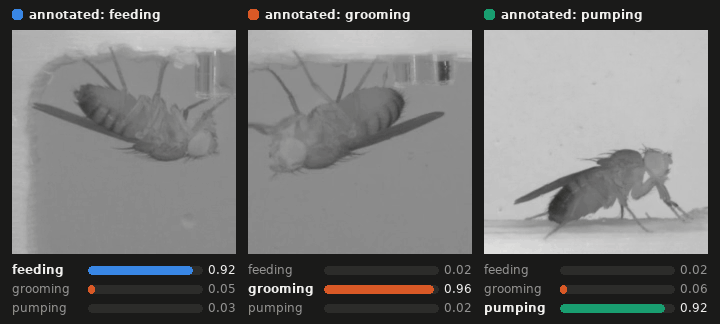
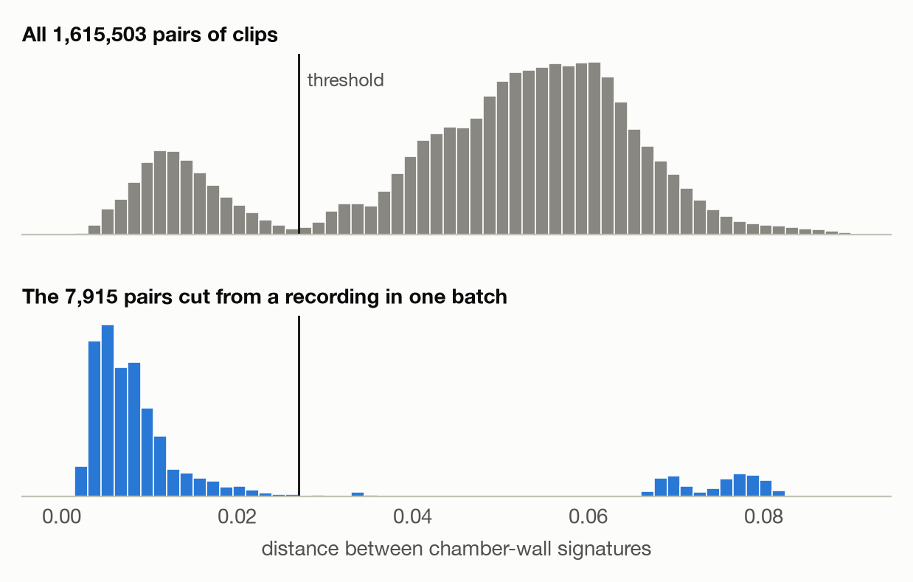
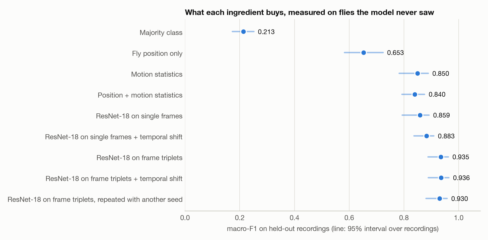
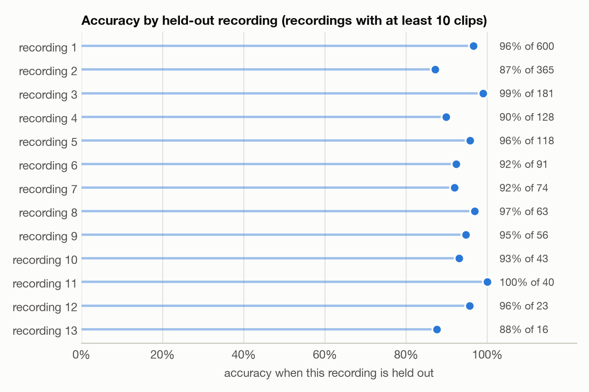
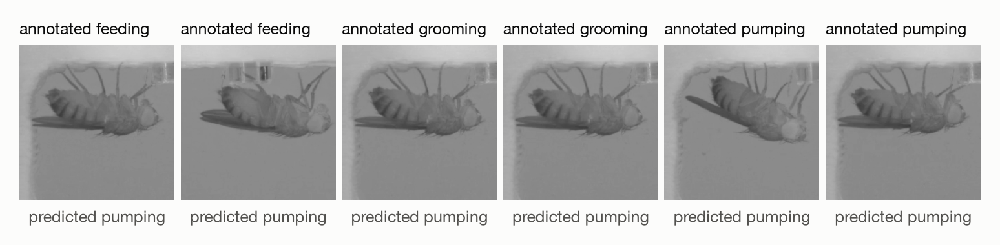

# Fruit-Fly-Action-Detection

A video classifier that tells **feeding**, **grooming** and **proboscis pumping** apart in
infrared footage of a single fruit fly, with an evaluation built around the one question
that matters for such a model: how well does it do on a fly it has never seen?



*Three clips from recordings that were held out of training. The bars are the model's
output for the two seconds around each frame.*

| Evaluated on recordings held out of training | Accuracy | Macro-F1 |
|---|---|---|
| Always predict the most common class | 47.0% | 0.213 |
| Hand-made motion statistics + gradient boosting | 85.2% | 0.850 |
| **This model** (ResNet-18 on three-frame snippets) | **93.8%** | **0.935** |

**In short**

- The raw folder holds 11,134 video files, but only 1,798 distinct usable clips, cut
  from 13 recordings. Class and recording are entangled, so the model is always tested on
  whole recordings it never saw. A random split of the same clips reports 97.2%, hiding more than half of the errors.
- The model follows the fly with a tracked crop and feeds an ordinary image network three
  frames at a time through its colour channels. That input trick is worth 7.5 points of
  macro-F1; a temporal-shift architecture on top of it added nothing and was dropped.
- It is right on 93.8% of held-out clips (95% interval over recordings: 90 to 96%). Most
  of what is left are clips in which the fly barely moves, where the footage itself is
  ambiguous. [Section 3.4](#34-the-catch-how-much-the-fly-moves-nearly-gives-the-class-away)
  is the part to read before trusting the number.

---

## Contents

1. [What is in the data](#1-what-is-in-the-data)
2. [Method](#2-method)
3. [Results](#3-results)
4. [Limitations](#4-limitations)
5. [Using it](#5-using-it)
6. [Repository layout](#6-repository-layout)

---

## 1. What is in the data

The raw material is a folder tree of short AVI clips, each showing one bout of one
behaviour, cut out of many-hour recordings of single flies in a 3D-printed chamber
(infrared camera, 30 FPS; the setup is described in the thesis that accompanies the data,
see [Acknowledgements](#acknowledgements)). Three things about it decide how a model has
to be built and judged.

### 1.1 Most files are copies

The dataset was curated in several rounds and each round was saved as a full, renamed
copy (`Action_v3` ... `Action_v6`, `400-Feeding`, zip exports, ...). Neither folder nor
file name identifies a clip, so everything here is keyed on a hash of the file contents.

| | |
|---|---|
| AVI files on disk | 11,134 (41.5 GB) |
| Unique clips | 1,810 |
| Usable clips (8 are corrupt, 4 are shorter than 16 frames) | **1,798** |
| Footage | 847,772 frames = 7.85 hours |
| Classes | feeding 846 · grooming 540 · pumping 412 |
| Clip length | median 7 to 11 s by class, range 0.6 s to 4.4 min |

Without de-duplication the same clip would sit in the training set up to 15 times, and in
the training and the test set at once.

### 1.2 The clips come from 13 recordings, and that is the unit that matters

Clips cut from one recording show the same fly in the same chamber under the same light,
often in the same pose seconds apart. A model can score well on such clips by recognising
the *recording* instead of the *behaviour*, so an honest test set has to consist of whole
recordings the model never saw. The renamed files no longer say which recording they came
from, so this is reconstructed from the pixels (`src/flyact/sessions.py`):

- The chamber is 3D printed. Its walls have a ragged outline and it sits a few pixels
  differently in every experiment, which makes the **edge map of the outer band of the
  frame a fingerprint of the recording**.
- Edges are normalised per clip (robust to lighting changes within an experiment) and
  compared with a trimmed mean (robust to the fly standing in front of a wall).
- Average-linkage clustering of those distances gives the recordings. Clips with
  different frame sizes are never joined.

The distances are cleanly bimodal, and the grouping can be checked against information the
clustering never saw: 412 clips still carry their original names, and their file
timestamps show that they were cut from the recordings in 21 batches.



Nineteen of the 21 batches fall inside a single cluster. The other two each span two
clusters (the pairs on the right); those clusters are merged, so that the final groups err
towards being too coarse, which is safe, rather than too fine, which leaks. The result is
13 recordings:


Class and recording are badly entangled: two recordings hold 54% of all clips, grooming
occurs in only three, one recording contains nothing but feeding and two contain nothing
but pumping.

### 1.3 A random split overstates accuracy

To put a number on it, the final model was also trained and tested the way such datasets
usually are, with clips split at random:

| Same model, same data, same number of folds | Accuracy | Macro-F1 | Errors |
|---|---|---|---|
| Clips split at random | 97.2% | 0.970 | 51 |
| Whole recordings held out (used everywhere else in this README) | 93.8% | 0.935 | 112 |

Nothing about the model changed between the two rows. With a random split every test clip
has neighbours from its own recording in the training set, and the error rate looks less
than half of what it is on a new fly (2.8% against 6.2%).

---

## 2. Method

### 2.1 Look at the fly, not at the chamber

A fly covers roughly 5% of the frame. Shrinking the whole 1100x800 frame to the 160 px
the network works at would make a leg less than a pixel wide. Instead the fly is located
in every clip and the network receives a window that follows it
(`src/flyact/tracking.py`).


- **Detection needs no background model**, which matters because many clips are a few
  seconds of a fly that never moves. The fly is the largest blob that is darker than its
  surroundings, where "surroundings" is a grey-scale closing with a kernel larger than the
  fly.
- **The window is centred on the body, not on the blob.** Wings and their shadows drag a
  plain centroid far enough to push the head out of view; the centre is computed from the
  thick part of the blob only.
- **The window moves smoothly.** Detections are median-filtered and then smoothed over
  half a second, so leg and wing movements do not shake the crop and inject motion that
  the fly never made.

The detector found the fly in 99.99% of the sampled frames (in every sampled frame of all
clips but one). Crops are stored once as small H.264 files, about 1 GB for everything,
that support random access.

### 2.2 Spend the colour channels on time

The footage is monochrome, so the three input channels of an ImageNet-pretrained network
would carry the same image three times. Here they carry three frames 67 ms apart instead.
Motion becomes visible *inside* a single input image: whatever stood still is grey,
whatever moved has colour fringes.


One input window is 8 such snippets spaced 0.27 s apart, i.e. 2 seconds of behaviour.

### 2.3 A plain 2D network, on purpose

Each snippet goes through an ImageNet-pretrained ResNet-18 and the eight snippet outputs
are averaged. There is no 3D convolution and no recurrent or attention layer; the only
temporal modelling is the three frames in the input channels.

The obvious alternative, a Kinetics-pretrained 3D CNN, was ruled out by measurement rather
than taste. Training throughput on the Apple M4 Pro GPU this was developed on
(`scripts/benchmark_backbones.py`):

| Backbone | Input | Clips / s |
|---|---|---|
| **ResNet-18 on frame triplets (this repo)** | 8 x 160 x 160 | **79** |
| ... with temporal shift | 8 x 160 x 160 | 67 |
| R(2+1)D-18 | 16 x 112 x 112 | 5.1 |
| MC3-18 | 16 x 112 x 112 | 5.2 |
| R3D-18 | 16 x 112 x 112 | 5.1 |
| S3D | 16 x 224 x 224 | 7.4 |
| Swin3D-T | 16 x 224 x 224 | 6.2 |

Forward, backward and optimiser step on random input, batch of 8 clips (4 for the two
224 px models, which do not fit in memory at 8). That gap is the difference between one
experiment per day and a full five-fold
cross-validation in about 40 minutes, which is what made the ablations in
[Section 3](#3-results) affordable.

The first version of this model also used the temporal shift module of
[Lin et al. (2019)](https://arxiv.org/abs/1811.08383), which lets the eight snippets
exchange information inside the backbone. It made no measurable difference, so it was
removed from the model and kept as an ablation.

### 2.4 Training

| | |
|---|---|
| Initialisation | ImageNet |
| Optimiser | AdamW, lr 3e-4, weight decay 0.01, one warm-up epoch, cosine decay |
| Schedule | 15 epochs, batch 32, one random window per clip per epoch |
| Loss | cross-entropy, label smoothing 0.1, classes sampled equally often |
| Augmentation | rotation ±15°, zoom 0.8 to 1.25, shift, mirror, gamma, contrast, playback speed −25% to +33%; identical for all frames of a window |
| Normalisation | per window, because recordings differ in brightness by a factor of two |
| Test time | up to 10 evenly spaced windows per clip, probabilities averaged |

### 2.5 Evaluation protocol

- **Five-fold cross-validation over recordings.** Every clip is predicted exactly once, by
  a model that never saw its recording. Folds are chosen to balance class counts using
  labels and group ids only (`sessions.assign_folds`).
- **No model selection on test data.** There is no early stopping and no checkpoint
  picking: each model trains for the fixed schedule and the last weights are evaluated.
- **Every run is reported.** The table in Section 3.1 lists each configuration that was
  trained under this protocol, including the ones that did not help.
- **Intervals resample recordings, not clips**, because new recordings are what the model
  will meet. Differences between two models are computed on the same resampled recordings
  (`metrics.paired_difference`), which is what allows small differences to be judged.

---

## 3. Results

### 3.1 All runs

| Model | Accuracy | Balanced acc. | Macro-F1 | 95% CI (recordings) | F1 feeding | F1 grooming | F1 pumping |
|---|---|---|---|---|---|---|---|
| Majority class | 0.470 | 0.333 | 0.213 | 0.17 to 0.25 | 0.640 | 0.000 | 0.000 |
| Fly position only | 0.665 | 0.665 | 0.653 | 0.58 to 0.72 | 0.715 | 0.480 | 0.763 |
| Motion statistics | 0.852 | 0.853 | 0.850 | 0.78 to 0.89 | 0.866 | 0.816 | 0.868 |
| Position + motion statistics | 0.843 | 0.843 | 0.840 | 0.79 to 0.88 | 0.859 | 0.792 | 0.867 |
| ResNet-18 on single frames | 0.871 | 0.863 | 0.859 | 0.79 to 0.89 | 0.909 | 0.866 | 0.802 |
| ResNet-18 on single frames + temporal shift | 0.893 | 0.886 | 0.883 | 0.84 to 0.91 | 0.931 | 0.874 | 0.844 |
| **ResNet-18 on frame triplets** | 0.938 | 0.937 | **0.935** | 0.89 to 0.96 | 0.951 | 0.926 | 0.927 |
| ResNet-18 on frame triplets + temporal shift | 0.939 | 0.939 | 0.936 | 0.89 to 0.96 | 0.949 | 0.932 | 0.927 |
| ResNet-18 on frame triplets, repeated with another seed | 0.933 | 0.934 | 0.930 | 0.88 to 0.96 | 0.945 | 0.921 | 0.925 |

Accuracy, balanced accuracy and macro-F1 over all 1,798 clips, each predicted by a model
that never saw its recording. The interval is for macro-F1. Paired comparisons between
runs and further breakdowns are in [docs/results.md](docs/results.md).



### 3.2 What each ingredient contributes

Reading the table from the top, each row adds one thing.

- **Where the fly is** (0.653). Feeding happens at the food port, so position alone is far
  better than the majority class (0.213), and far from enough.
- **How much the image changes** (0.850). Twenty-seven numbers describing frame
  differences, fed to gradient boosting, with no network involved.
  [Section 3.4](#34-the-catch-how-much-the-fly-moves-nearly-gives-the-class-away)
  explains why this is so strong.
- **What a single frame looks like** (0.859). An image classifier that never sees motion
  gets as far as the motion statistics, from the opposite direction: posture and context.
- **Three frames instead of one** (0.935). The only change from the row above is that the
  three colour channels carry three moments in time. The gain is +0.075 macro-F1 with a
  95% interval of +0.051 to +0.110 over recordings. This is the step that matters.
- **Temporal shift.** Letting the eight snippets of a window exchange information inside
  the backbone is a different way to give the network motion, at a coarser time scale
  (0.27 s between snippets instead of 67 ms between channels). On single frames it helps,
  0.859 to 0.883. On top of frame triplets it changes nothing: 0.936 against 0.935, a
  difference of 0.001 with an interval of −0.006 to +0.011. The four runs form a 2 x 2:

  | Macro-F1 | no temporal shift | temporal shift |
  |---|---|---|
  | single frames | 0.859 | 0.883 |
  | frame triplets | **0.935** | 0.936 |

  The model without temporal shift is the simpler of two equally good ones, so it is the
  model. As a side effect it accepts windows of any number of snippets.
- **Run-to-run variation.** Training the final model again with another random seed gives
  0.930, a difference of 0.004 (interval −0.006 to +0.015). That is the yardstick for
  everything above: the temporal-shift difference is inside it, and the gain from frame
  triplets is more than ten times larger.

### 3.3 Where it is right and wrong

<p>


</p>

The three classes are recognised about equally well (F1 0.951, 0.926 and 0.927), and no
recording falls below 87%. The weakest one, recording 2, is discussed next.

### 3.4 The catch: how much the fly moves nearly gives the class away

Proboscis pumping happens while the fly is otherwise still; feeding and grooming involve
visible movement. In this dataset that difference is almost the whole story for one of
the three classes: **the average frame-to-frame change in the crop, a single number,
separates pumping from the other two classes with an AUC of 0.976.** That is why the
motion-statistics baseline reaches 85% without looking at the animal.

Splitting the clips into fifths by that number shows what the network adds and where it
stops:

| Motion in the clip | feeding: clips (accuracy) | grooming: clips (accuracy) | pumping: clips (accuracy) |
|---|---|---|---|
| stillest fifth | 36 (61%) | 8 (0%) | 316 (97%) |
| 2nd | 153 (86%) | 116 (94%) | 90 (90%) |
| 3rd | 150 (99%) | 207 (97%) | 3 (67%) |
| 4th | 230 (99%) | 126 (93%) | 3 (0%) |
| most motion | 277 (97%) | 83 (90%) | 0 |

- **Where the fly moves, the network does real work.** Telling feeding from grooming in
  the 60% of clips with the most motion, it is right 96.6% of the time, against 87.0% for
  the motion-statistics baseline.
- **Where the fly is still, it mostly answers "pumping".** In the stillest fifth it scores
  90.8%, barely above the 87.8% that always answering "pumping" would get. The 44 feeding
  and grooming clips in that fifth are right half the time, and four of the six pumping
  clips with more than a little motion are wrong.
- **63% of all errors (71 of 112) are in the stillest two fifths.** Many are of one kind:
  in recording 2, 27 clips show the fly hanging in the same spot in the same pose. Twelve
  are annotated pumping, eight grooming and seven feeding. The model calls 23 of the 27
  pumping and gets none of the 15 feeding and grooming clips right. Whether those labels reflect movements too small to see at this
  resolution or inconsistent annotation cannot be decided from the clips. It is not a
  matter of the fly being unfamiliar: in the random-split run of Section 1.3, where the
  model trained on other clips of this very fly, it still gets only 5 of the 15 feeding
  and grooming clips right.



*Six clips from recording 2 in which the fly barely moves, taken at the spot where it
usually rests: two annotated feeding, two grooming, two pumping. The model calls all six
pumping.*

So the headline number is honest about held-out flies, but it is a number for *this mix of
clips*. On footage where still flies are feeding or grooming more often than here, expect
less. Whether a higher input resolution recovers some of these clips is the obvious next
experiment; `configs/ablations/res224.yaml` is set up for it.

### 3.5 On a longer clip


The last 12 seconds of a clip annotated as grooming, from a recording held out of
training. The fly grooms its wings with its hind legs, then climbs to the ceiling and
walks about next to the food port; the prediction switches from grooming to feeding
within a few seconds. The switch shows the temporal resolution of the model and also a
limit of having three classes: walking is not one of them, and because clips annotated as
feeding often begin with the fly walking up to the food, walking is read as feeding.

### 3.6 Confidence is informative

Averaged probabilities are under-confident by design (label smoothing), but they rank
clips well: 70 of the 112 errors have a top probability below 0.6.

| Keep clips with top probability at least | Clips kept | Accuracy on those |
|---|---|---|
| 0.6 | 91.6% | 97.5% |
| 0.7 | 85.4% | 98.5% |
| 0.8 | 74.4% | 99.3% |

A practical use: accept confident predictions and send the rest to a human.

---

## 4. Limitations

- **It is a closed-set classifier.** The model always answers feeding, grooming or
  pumping, also for a fly that is asleep or walking (Section 3.5). It classifies bouts
  that someone has already found; it does not find them in a continuous recording.
  Turning it into a detector needs negative examples, footage showing none of the three,
  which this dataset does not contain.
- **Stillness stands in for pumping.** See Section 3.4. This is a property of the data as
  much as of the model, and more data of still flies that are feeding or grooming is the
  fix, not a bigger network.
- **Thirteen flies, one rig.** Every clip comes from the same chamber design, camera and
  lab. The intervals describe variation between these recordings, not what happens with
  different optics or a different chamber.
- **Grooming was learned from three flies.** It occurs in three recordings only, so in
  each fold the model has seen grooming in at most two animals.
- **Labels are per clip.** A clip annotated as feeding often starts with the fly walking
  up to the food. Windows from such stretches are trained on, and scored, as feeding.
- **Recordings are inferred.** The grouping agrees with the available metadata but was
  never confirmed against the original experiment log. If two groups were in fact the
  same fly, the estimates would be optimistic for the clips involved.

---

## 5. Using it

### Install

```bash
git clone https://github.com/kircova/Fruit-Fly-Action-Detection.git
cd Fruit-Fly-Action-Detection
python -m venv .venv && source .venv/bin/activate
pip install -e ".[dev]"
pytest          # 48 tests, under a minute, no data needed
```

Python 3.10 or newer. Runs on Apple silicon (MPS), CUDA or CPU; the device is picked
automatically.

### Reproduce everything

The raw clips are not part of this repository. Point `FLYACT_DATA_ROOT` at the folder
that holds them (any layout; classes are read from file and folder names) and run:

```bash
export FLYACT_DATA_ROOT=/path/to/clips

flyact index        # hash and de-duplicate the files          -> data/manifest.csv
flyact preprocess   # track the fly, write fly-centred crops   -> cache/        (~16 min)
flyact sessions     # recover recordings, assign folds         -> data/manifest.csv

flyact baselines                                       # non-neural baselines
flyact train --config configs/triplet_2d.yaml          # the model, 5-fold      (~40 min)
flyact train --config configs/ablations/static_2d.yaml # ... and each ablation
flyact report                                          # docs/results.md, docs/figures/
```

`scripts/reproduce.sh` runs all of it. `data/manifest.csv` is checked in, so the exact
clips, recordings and folds behind the numbers above are fixed.

### Classify a video

```bash
flyact train --config configs/triplet_2d.yaml --final    # one model on all the data
flyact predict some_bout.avi --checkpoint runs/triplet_2d/final.pt
```

```
some_bout.avi: grooming (mean probability 0.94)
  feeding=0.04  grooming=0.94  pumping=0.02
 start_s  end_s behaviour  confidence
     0.0  11.03  grooming       0.941
```

The video goes through the same tracking and cropping as the training clips. For a video
longer than one window, `predict` slides a window along it and prints the stretches where
the prediction is stable; `--csv` writes per-window probabilities. Trained weights are not
stored in the repository.

### Look at the mistakes

```bash
python scripts/contact_sheet.py runs/triplet_2d --out errors.jpg
```

renders the misclassified clips, most confident mistakes first. This is the quickest way
to tell model errors from label noise.

### Re-render the animations

```bash
flyact train --config configs/triplet_2d.yaml --set train.save_checkpoints=true
python scripts/make_gifs.py     # needs ffmpeg
```

Every prediction shown in the animations comes from the fold model that never saw the
clip's recording.

---

## 6. Repository layout

```
src/flyact/
  index.py        content-hash de-duplication, labels from paths        -> manifest
  tracking.py     fly detection and smooth window trajectory
  preprocess.py   two-pass crop cache builder
  video.py        PyAV reading, seekable H.264 cache writing
  sessions.py     recording recovery, cross-check, grouped folds
  data.py         window sampling, augmentation, dataset
  model.py        ResNet-18 over snippets (optional temporal shift)
  train.py        training loop, grouped cross-validation
  baselines.py    position and motion-statistics baselines
  metrics.py      scores, bootstrap intervals, paired comparisons
  report.py       results tables and figures
  predict.py      inference on new videos
  cli.py          the `flyact` command
configs/          the model and its ablations
scripts/          reproduce.sh, backbone benchmark, error contact sheets, GIF renderer
tests/            unit tests and an end-to-end run on synthetic videos
data/manifest.csv one row per clip: hash, label, recording, fold, tracking stats
docs/             generated results tables, figures and animations
```

## Acknowledgements

The clips were cut from recordings made for the study of sleep behaviour in *Drosophila*
described in A. O. B. Şapcı, *Automated Behavioral Analysis of Asleep Fruit Fly* (MSc
thesis, Sabancı University, 2022), which introduced the
[basty](https://github.com/bo1929/basty) pipeline and the behaviour categories used here.
The recordings themselves are not redistributed in this repository. The temporal shift
module evaluated in the ablations is from J. Lin, C. Gan and S. Han, *TSM: Temporal Shift
Module for Efficient Video Understanding*, ICCV 2019.
