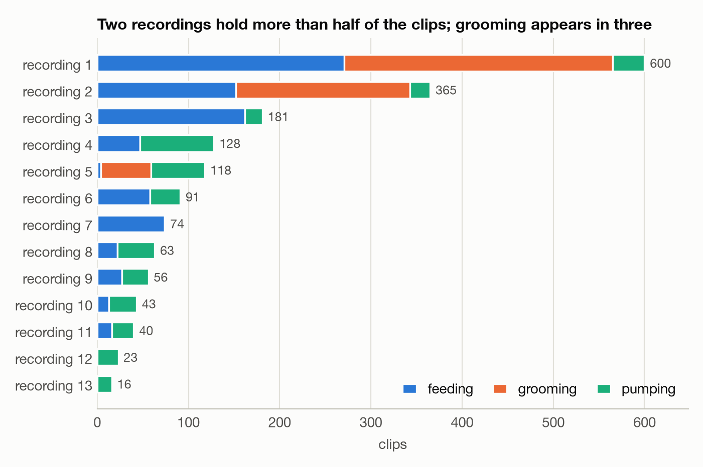
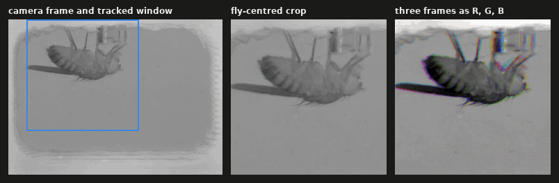
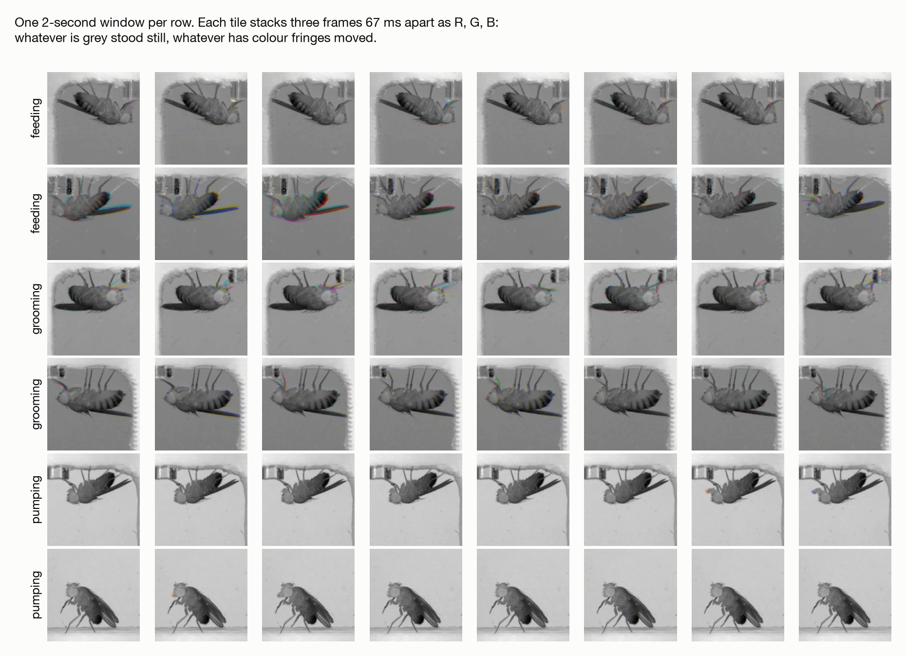
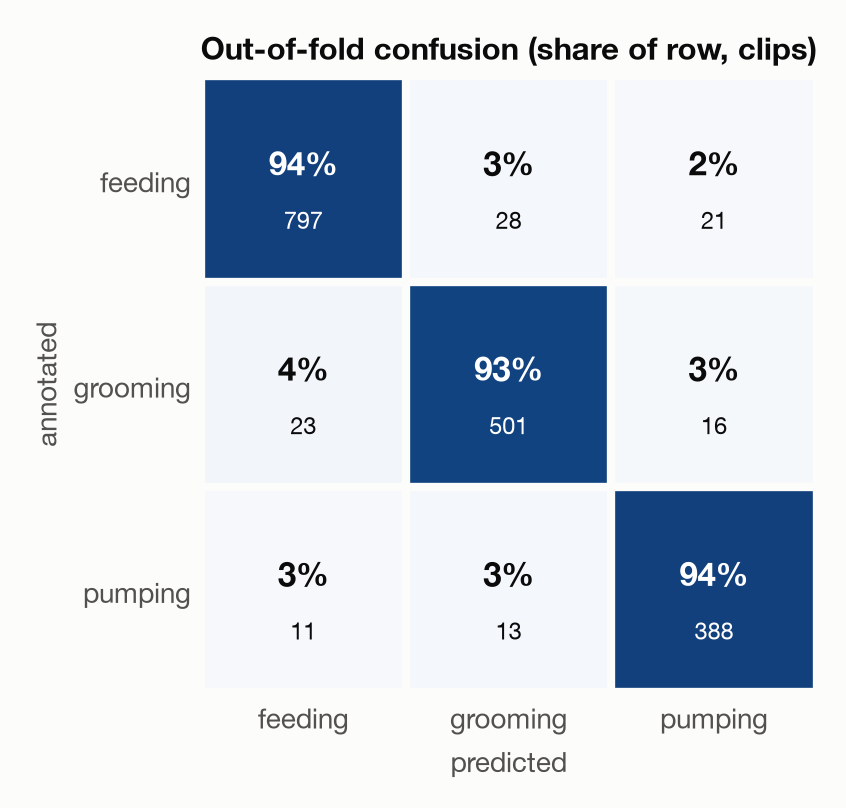
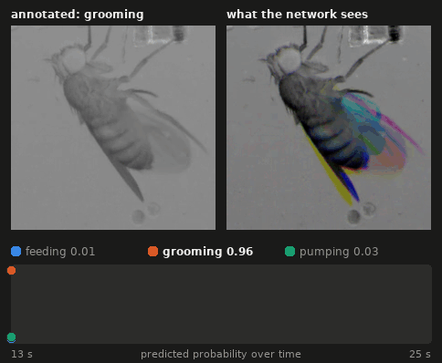

# Fruit-Fly-Sleep-Behaviour-Detection

Classifying what a fruit fly is doing (feeding, grooming or proboscis pumping) from
infrared video of a single fly in a small chamber.


The three clips above come from recordings the model was not trained on. The bars show
its output for the two seconds around each frame.

The classifier is a ResNet-18 that looks at a crop around the fly, three frames at a time.
On recordings held out of training it gets 93.8% of the clips right (macro-F1 0.935). For
comparison, always predicting the most common class gives 47%, and a simple baseline built
on frame differences gives 85%.

## Data

The clips are short AVI files with one bout of one behaviour each. They were cut from
recordings that run for many hours, each of a single fly in a 3D-printed chamber, filmed
with an infrared camera at 30 FPS. The footage is from the Wu Lab at Johns Hopkins
University, and the experiments are described in the papers listed in the
acknowledgements.

| | |
|---|---|
| Files on disk | 11,134 AVIs, 41.5 GB |
| Unique clips | 1,810 |
| Usable clips | 1,798 (8 would not decode, 4 were under 16 frames) |
| Total footage | 7.85 hours |
| Per class | feeding 846, grooming 540, pumping 412 |
| Clip length | median 7 to 11 s depending on the class, from 0.6 s up to 4.4 min |

There were two problems to sort out before training anything.

### Duplicates

I had saved several versions of the dataset over time (`Action_v3` to `Action_v6`,
`400-Feeding`, zip exports and so on), and every version renamed the files. Most of the
11,134 files are therefore copies. Some clips exist 15 times, and the file names do not
tell you which is which. `flyact index` hashes the file contents and keeps one copy of
each clip.

### Which recording a clip comes from

All clips from one recording show the same fly in the same chamber, often only seconds
apart. If clips from one recording end up in both the training and the test set, the
model can score well just by recognising the recording, and the test accuracy says little
about a new fly. I wanted to hold out whole recordings instead, but after all the renaming
the file names no longer say which recording a clip belongs to.

I got this back from the images. The chamber is 3D printed, its walls have a rough
outline, and it sits in a slightly different place in every experiment. `flyact sessions`
computes an edge map of the outer part of the frame for every clip, compares all pairs of
clips and clusters them. The distances fall into two well separated groups, pairs from
the same recording and pairs from different ones:


As a check, 412 clips still have their original file names, and their timestamps show
that they were cut in 21 batches. 19 of those batches land in a single cluster. The other
two span two clusters each, and I merged those to be on the safe side. That leaves 13
recordings:



The classes are spread very unevenly. Two recordings hold 54% of the clips, grooming only
appears in three recordings, and a few recordings contain a single class.

To see how much the split matters I also ran the final model with an ordinary random
split of the clips:

| Split | Accuracy | Macro-F1 | Errors |
|---|---|---|---|
| Random split of clips | 97.2% | 0.970 | 51 |
| Whole recordings held out | 93.8% | 0.935 | 112 |

It is the same model and the same data in both rows. Everything below uses the second
protocol.

## Method

### Cropping around the fly

The fly takes up about 5% of the frame. At the 160 px input size I train with, a leg
would be less than a pixel wide if I used the full frame, so every clip is first reduced
to a square window that follows the fly (`src/flyact/tracking.py`).



The fly is found as the largest blob that is darker than its surroundings, using a
morphological closing as the reference. This needs no background model, so it also works
for clips where the fly does not move at all. The window is centred on the thick part of
the blob, because wings and their shadows pull a plain centroid far enough from the body
to cut off the head. The trajectory is smoothed over half a second so that the crop does
not jitter. The crops are saved once as small H.264 files, about 1 GB in total.

### Three frames as one image

The video is greyscale. Instead of giving the network the same image in all three colour
channels, each input image holds three frames that are 67 ms apart. Whatever stood still
stays grey and whatever moved gets coloured edges:



One training sample is 8 of these images, 0.27 s apart, which covers about 2 seconds.

### Model

An ImageNet-pretrained ResNet-18 is applied to each of the 8 images and the outputs are
averaged. There is no 3D convolution and no recurrent layer. I chose a 2D network mostly
for speed. On my machine (Apple M4 Pro, MPS) the 3D models in torchvision train at 5 to
7 clips per second, and this one at about 79:

| Backbone | Input | Clips/s |
|---|---|---|
| ResNet-18 on three-frame images (this repo) | 8 x 160 x 160 | 79 |
| same, with temporal shift | 8 x 160 x 160 | 67 |
| R(2+1)D-18 | 16 x 112 x 112 | 5.1 |
| MC3-18 | 16 x 112 x 112 | 5.2 |
| R3D-18 | 16 x 112 x 112 | 5.1 |
| S3D | 16 x 224 x 224 | 7.4 |
| Swin3D-T | 16 x 224 x 224 | 6.2 |

These numbers are from `scripts/benchmark_backbones.py`, with a batch of 8 clips (4 for
the two 224 px models, which did not fit in memory at 8). With the 2D model a full 5-fold
cross-validation takes about 40 minutes.

### Training

AdamW with learning rate 3e-4 and weight decay 0.01, 15 epochs with one warm-up epoch and
cosine decay, batch size 32, label smoothing 0.1, classes sampled equally often.
Augmentation is rotation up to 15°, zoom, small shifts, horizontal flip, gamma and
contrast changes and a change of playback speed, with the same transform applied to every
frame of a sample. Inputs are normalised per sample because brightness differs a lot
between recordings. At test time the prediction for a clip is the average over up to 10
windows.

### Evaluation

5-fold cross-validation in which every fold is a set of whole recordings, so each clip is
predicted by a model that has not seen its recording. Models are trained for a fixed
number of epochs and the last checkpoint is evaluated, without early stopping on the test
folds. The confidence intervals are bootstrapped over recordings.

## Results

| Model | Accuracy | Macro-F1 | 95% CI (macro-F1) |
|---|---|---|---|
| Majority class | 0.470 | 0.213 | 0.17 to 0.25 |
| Position of the fly only | 0.665 | 0.653 | 0.58 to 0.72 |
| Motion statistics | 0.852 | 0.850 | 0.78 to 0.89 |
| Position + motion statistics | 0.843 | 0.840 | 0.79 to 0.88 |
| ResNet-18, single frames | 0.871 | 0.859 | 0.79 to 0.89 |
| ResNet-18, single frames + temporal shift | 0.893 | 0.883 | 0.84 to 0.91 |
| **ResNet-18, three frames (final model)** | **0.938** | **0.935** | 0.89 to 0.96 |
| ResNet-18, three frames + temporal shift | 0.939 | 0.936 | 0.89 to 0.96 |
| ResNet-18, three frames, second seed | 0.933 | 0.930 | 0.88 to 0.96 |


Some notes on the table:

- The position baseline uses only where the tracked window is and how much it moves. It
  does better than chance because feeding happens at the food port.
- The motion baseline is gradient boosting on 27 frame-difference statistics. It is
  stronger than I expected, see the next section.
- A network on single frames, with no motion information, is about as good as the motion
  statistics.
- Going from one frame to three frames per image is the biggest step, +0.075 macro-F1
  (95% CI +0.051 to +0.110).
- I also tried the temporal shift module (TSM), which lets the 8 images exchange
  information inside the network. It helps with single frames (0.859 to 0.883) but makes
  no difference with three-frame images (0.936 against 0.935), so the final model does not
  use it.
- A second run of the final model with another seed gave 0.930, so differences of around
  0.005 are within noise.

Paired comparisons between the runs and a few more breakdowns are in
[docs/results.md](docs/results.md).

<p>


</p>

F1 is 0.95 for feeding and 0.93 for grooming and pumping. Accuracy per held-out recording
is between 87% and 100%.

### Where it goes wrong

Pumping happens while the fly is otherwise still, and feeding and grooming involve much
more movement. In this dataset that already separates the classes quite well: the mean
frame-to-frame change in the crop tells pumping apart from the other two with an AUC of
0.976. This is why the motion baseline reaches 85%.

Accuracy of the final model, with the clips split into fifths by how much motion they
contain:

| Motion in the clip | feeding: clips (accuracy) | grooming: clips (accuracy) | pumping: clips (accuracy) |
|---|---|---|---|
| stillest fifth | 36 (61%) | 8 (0%) | 316 (97%) |
| 2nd | 153 (86%) | 116 (94%) | 90 (90%) |
| 3rd | 150 (99%) | 207 (97%) | 3 (67%) |
| 4th | 230 (99%) | 126 (93%) | 3 (0%) |
| most motion | 277 (97%) | 83 (90%) | 0 |

When the fly moves, the model does well. For feeding against grooming in the 60% of clips
with the most motion it is right 96.6% of the time, compared with 87.0% for the motion
baseline. When the fly is still, it mostly predicts pumping. In the stillest fifth it
reaches 90.8%, and always answering "pumping" there would give 87.8%. 71 of the 112 errors
are in the two stillest fifths.

Many of these come from recording 2. In 27 of its clips the fly sits in the same spot in
the same pose, and 12 of them are labelled pumping, 8 grooming and 7 feeding. The model
says pumping for 23 of them and gets none of the 15 feeding and grooming clips right. Even
with the random split, where it has seen other clips of this fly, it only gets 5 of those
15. I cannot tell from the video whether the movements are too small to see at this
resolution or whether the labels are inconsistent.


So the 93.8% depends on the mix of clips in this dataset. I have not tried a higher input
resolution yet; `configs/ablations/res224.yaml` is there for it.

### A longer clip



These are the last 12 seconds of a held-out clip labelled grooming. The fly grooms its
wings, then climbs to the ceiling and walks around near the food port, and the prediction
changes to feeding. There is no walking class, and many feeding clips start with the fly
walking to the food, so walking tends to come out as feeding.

### Confidence

The predicted probabilities are useful for filtering. 70 of the 112 errors have a top
probability below 0.6.

| Keep clips with top probability at least | Clips kept | Accuracy on those |
|---|---|---|
| 0.6 | 91.6% | 97.5% |
| 0.7 | 85.4% | 98.5% |
| 0.8 | 74.4% | 99.3% |

## Limitations

- There are only three classes and the model always outputs one of them, also when the
  fly is asleep or walking. It works on clips that were already cut out and cannot find
  bouts in a long recording. The dataset has no footage without one of the three
  behaviours, which would be needed for that.
- 13 flies and one setup. I do not know how it does with another chamber or camera.
- Grooming only occurs in three recordings.
- Labels are per clip. A feeding clip often includes the walk to the food.
- The assignment of clips to recordings is inferred from the images. It agrees with the
  metadata I have, but I could not check it against the original experiment logs.

## Setup

```bash
git clone https://github.com/kircova/Fruit-Fly-Sleep-Behaviour-Detection.git
cd Fruit-Fly-Sleep-Behaviour-Detection
python -m venv .venv && source .venv/bin/activate
pip install -e ".[dev]"
pytest          # 48 tests, no data needed
```

Python 3.10 or newer. It runs on Apple silicon (MPS), CUDA or CPU.

The raw clips are not in this repository. To rerun everything, point `FLYACT_DATA_ROOT`
at the folder with the clips (classes are read from file and folder names):

```bash
export FLYACT_DATA_ROOT=/path/to/clips

flyact index        # hash and de-duplicate the files        -> data/manifest.csv
flyact preprocess   # track the fly and write the crops      -> cache/   (about 16 min)
flyact sessions     # find the recordings, assign folds      -> data/manifest.csv

flyact baselines
flyact train --config configs/triplet_2d.yaml          # 5-fold, about 40 min
flyact train --config configs/ablations/static_2d.yaml # same for the other ablations
flyact report                                          # docs/results.md, docs/figures/
```

`scripts/reproduce.sh` runs all of it. `data/manifest.csv` is checked in, so the clips,
recordings and folds behind the numbers are fixed.

To classify a video:

```bash
flyact train --config configs/triplet_2d.yaml --final    # one model on all the data
flyact predict some_bout.avi --checkpoint runs/triplet_2d/final.pt
```

```
some_bout.avi: grooming (mean probability 0.94)
  feeding=0.04  grooming=0.94  pumping=0.02
 start_s  end_s behaviour  confidence
     0.0  11.03  grooming       0.941
```

The video goes through the same tracking and cropping as the training clips. For longer
videos `predict` slides a window over the video and prints the stretches where the
prediction stays the same; `--csv` writes the probabilities per window. Trained weights
are not stored in the repository.

Two more scripts: `scripts/contact_sheet.py runs/triplet_2d` renders the misclassified
clips, which is the quickest way to look at the errors, and `scripts/make_gifs.py`
re-renders the animations (needs ffmpeg, and fold checkpoints from
`flyact train ... --set train.save_checkpoints=true`). The predictions in the animations
always come from the fold model that did not see the clip's recording.

## Repository layout

```
src/flyact/
  index.py        de-duplication by content hash, labels from paths
  tracking.py     fly detection and window trajectory
  preprocess.py   builds the crop cache
  video.py        video reading and writing (PyAV)
  sessions.py     recovers the recordings, assigns folds
  data.py         window sampling, augmentation, dataset
  model.py        ResNet-18 over three-frame images (temporal shift optional)
  train.py        training and cross-validation
  baselines.py    position and motion baselines
  metrics.py      scores, bootstrap intervals, paired comparisons
  report.py       tables and figures
  predict.py      inference on new videos
  cli.py          the flyact command
configs/          final model and ablations
scripts/          reproduce.sh, benchmark, error contact sheets, GIF rendering
tests/            unit tests and an end-to-end test on synthetic videos
data/manifest.csv one row per clip: hash, label, recording, fold, tracking stats
docs/             results tables, figures and animations
```

## Acknowledgements

The footage used in this project belongs to Mehmet F. Keleş and the Wu Lab at Johns
Hopkins University. All clips were cut from recordings of their sleep experiments in
*Drosophila*. The recording setup and the behaviours annotated in it are described in:

- M. F. Keleş, A. O. B. Sapci, C. Brody, I. Palmer, A. Mehta, S. Ahmadi, C. Le,
  Ö. Taştan, S. Keleş and M. N. Wu, *FlyVISTA, an integrated machine learning platform
  for deep phenotyping of sleep in Drosophila*, Science Advances 11, eadq8131 (2025).
  [doi:10.1126/sciadv.adq8131](https://doi.org/10.1126/sciadv.adq8131)
- A. O. B. Şapcı, *Automated Behavioral Analysis of Asleep Fruit Fly*, MSc thesis,
  Sabancı University, 2022, which introduced the
  [basty](https://github.com/bo1929/basty) pipeline.

The clips themselves are not part of this repository. The three animations and two of the
figures (`inputs.png`, `ambiguous.png`) show short excerpts from fewer than twenty clips,
and `data/manifest.csv` lists file name, label and tracking statistics for every clip
without any image data.

The temporal shift module used in the ablations is from J. Lin, C. Gan and S. Han, *TSM:
Temporal Shift Module for Efficient Video Understanding*, ICCV 2019.
